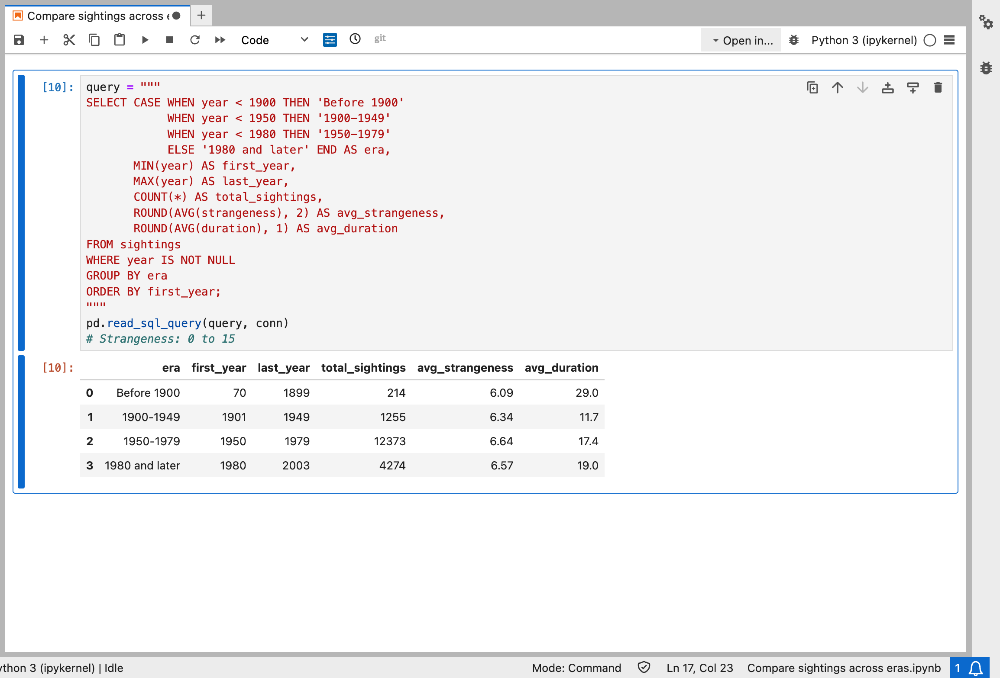

# lego9617.github.io

## Results

### How to read this table
- **era**: the time period each sighting was sorted into.
- **first_year / last_year**: the earliest and latest year of data in that period.
- **total_sightings**: how many reports fall in that period.
- **avg_strangeness**: the average strangeness score, on a scale of 0 to 15.
- **avg_duration**: the average duration of a sighting (unit to be confirmed).

### What it shows
Sightings jumped from 1,255 reports in 1900-1949 to 12,373 in 1950-1979, the peak of the dataset. Average strangeness barely changed, staying between about 6.1 and 6.6 in every era, so reports got more common without getting stranger. Average duration was highest before 1900 (29.0), but that period has only 214 sightings, so I treat it with caution.
