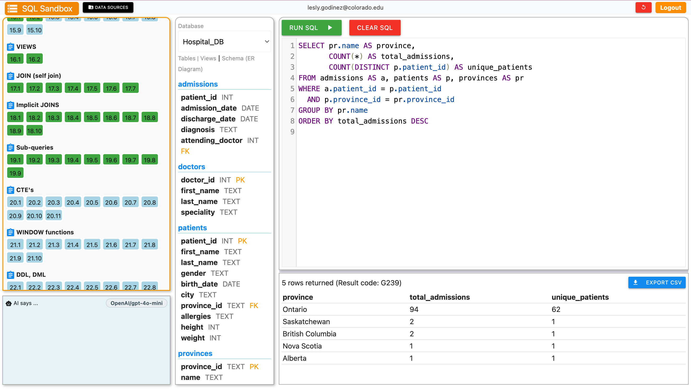
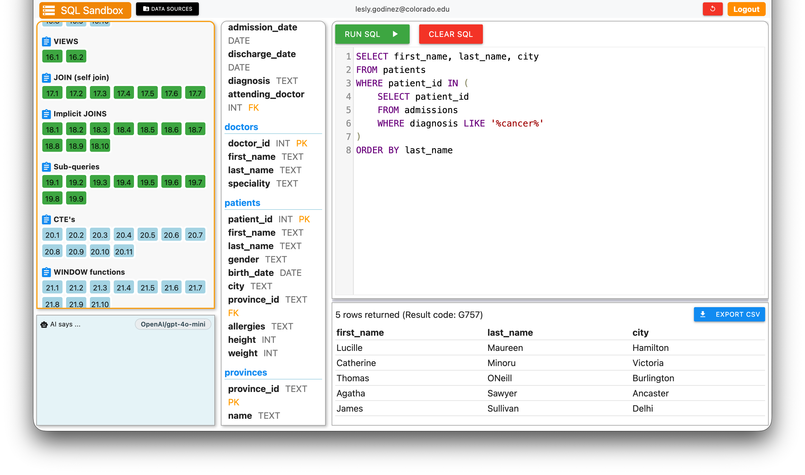

# lego9617.github.io

## Project 1 Results
# Hospital Admissions by Province (SQL Implicit Joins)

## Summary
I used an implicit join across three tables in a practice hospital database to find out how many admissions came from each province, and how many different patients were behind those admissions.

## Business Question
**Which provinces have the most hospital admissions?**

## How It Works
- **Implicit join:** the three tables are listed in FROM separated by commas, and the two conditions in WHERE connect them. Admissions link to patients through patient_id, and patients link to provinces through province_id.
- **COUNT(*)** counts every admission in each province.
- **COUNT(DISTINCT p.patient_id)** counts each patient once, so comparing the two columns shows where patients were admitted repeatedly.
- **GROUP BY pr.name ** creates one row per province, and ** ORDER BY ... DESC ** puts the busiest province first.

### Key findings
- Ontario had the most admissions, with 94 total admissions from 62 unique patients.
- Alberta had the fewest, with 1 admissions.
- There seems to be a massive gap between Ontario and Alberta but within Alberta and another province Nova Scotia have repeated numbers with 1 admission while the jump for the other two provinces like British Columbia and Saskatchewan closely fall behind with 2 admissions.  

---

## Project 2: Strangest Sightings by Locale

# Hospital Admissions Analysis: Cancer Patients (SQL Sandbox)

## Summary
I used SQL subqueries to find every patient admitted to a hospital with a cancer diagnosis, using a practice hospital database with four linked tables (patients, admissions, doctors, provinces).

## Question
**Which patients have been admitted with a cancer diagnosis?**

## How It Works
- **Inner query:** searches admissions for diagnoses containing "cancer" and returns those patient IDs.
- **Outer query:** pulls the names and cities of the patients on that list from patients.
- **Why IN instead of a join:** each patient appears once, even if they were admitted multiple times.
### Results

### Key findings
- The query returned 5 patients admitted with a cancer diagnosis.
- Patients came from 5 different cities, with none seemed to overlap or appear often.
- Each patient is listed once, even if they were admitted more than once, because the subquery uses IN.
- This is a practice dataset, so these results describe the sandbox and not real-world patients.
