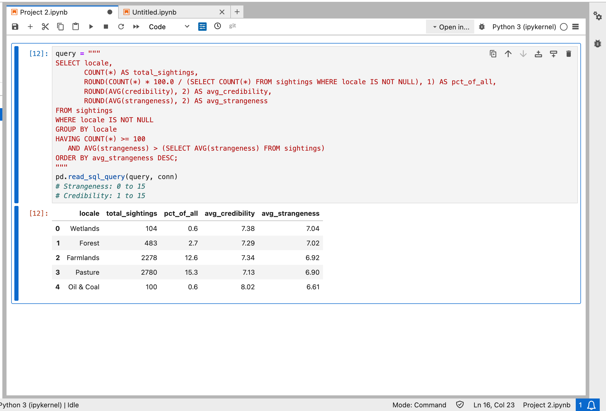

# lego9617.github.io

## Project 1 Results

### How to read this table
- **era**: the time period each sighting was sorted into.
- **first_year / last_year**: the earliest and latest year of data in that period.
- **total_sightings**: how many reports fall in that period.
- **avg_strangeness**: the average strangeness score, on a scale of 0 to 15.
- **avg_duration**: the average duration of a sighting (unit to be confirmed).

### What it shows
Sightings jumped from 1,255 reports in 1900-1949 to 12,373 in 1950-1979, the peak of the dataset. Average strangeness barely changed, staying between about 6.1 and 6.6 in every era, so reports got more common without getting stranger. Average duration was highest before 1900 (29.0), but that period has only 214 sightings, so I treat it with caution.

---

## Project 2: Strangest Sightings by Locale

### Question I asked
Which settings have the most sightings, and which ones produce above-average strangeness ratings?

### How it works
- GROUP BY locale gives one row per type of location.
- COUNT(*) counts the sightings, and the subquery in `pct_of_all` divides by the total to get each locale's share.
- HAVING COUNT(*) >= 100 keeps only locales with at least 100 sightings, so tiny samples don't skew the results.
- HAVING AVG(strangeness) > (SELECT ...) keeps only locales whose average strangeness beats the overall average.
- ORDER BY avg_strangeness DESC puts the strangest first.

### Results

### Key findings
- Every locale that beat the overall strangeness average is a rural, natural, or industrial setting.
- Wetlands and forests had the highest strangeness (about 7.0 out of 15).
- Pasture and farmlands had the most sightings, together about 28% of all reports with a locale.
- Oil & Coal had the highest credibility (8.02) but only 100 sightings and a strangeness only slightly above average, so I treat it with caution.

### Limitations
- Locales with fewer than 100 sightings were left out, so some settings aren't shown.
- Strangeness and credibility are subjective ratings, so differences of a few tenths may not be meaningful.
